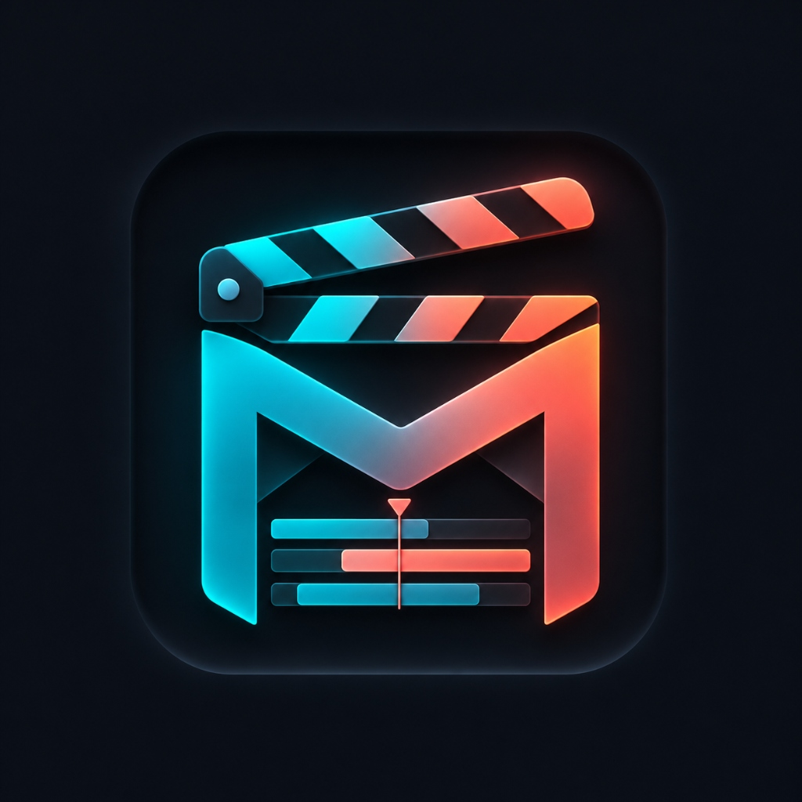

<p align="center">
  
</p>

<h1 align="center">🎬 MegaStage</h1>

<p align="center">
  <strong>100% Free & Local AI Desktop Video Studio for macOS (Apple Silicon), Windows & Linux</strong><br>
  Offline Neural Speech-to-Text • Neural Voice Cast • 3D Stage Diorama Preview • Multi-Track Video Timeline
</p>

<p align="center">
  <a href="https://github.com/subrasaas/mega-stage/releases"></a>
  <a href="https://megastage.subraspaceai.com"></a>
  <a href="https://github.com/subrasaas/mega-stage/blob/main/LICENSE"></a>
  <a href="https://github.com/subrasaas/mega-stage/actions"></a>
</p>

---

## 🌟 What is MegaStage?

**MegaStage** is an open, private-by-design desktop video editor built for creators, educators, and indie makers. 

Unlike traditional cloud video platforms that charge recurring monthly fees or send your private video drafts, audio, and scripts to third-party servers, **MegaStage runs entirely on your local machine**:

* ⚡ **Zero Cloud Bills & Zero Subscription Paywalls:** 100% free forever.
* 🔒 **Complete Data Privacy:** Your videos, recordings, and audio never leave your local hardware.
* 🚀 **Offline AI Engines:** Uses local Apple Silicon (Metal) and local GPU/CPU compute for transcription and voice synthesis.
* 📦 **Standard File Ownership:** Projects save as human-readable `.stage` files that you own forever.

---

## 📥 Download MegaStage Desktop

Download the latest installer directly from the [GitHub Releases](https://github.com/subrasaas/mega-stage/releases/latest) page:

| Operating System | Download Link | Package Format |
| :--- | :--- | :--- |
| **macOS (Apple Silicon M1/M2/M3/M4)** | [Download `.dmg`](https://github.com/subrasaas/mega-stage/releases/download/v1.0.0/MegaStage-1.0.0-arm64.dmg) | `.dmg` installer & [`.zip`](https://github.com/subrasaas/mega-stage/releases/download/v1.0.0/MegaStage-1.0.0-arm64-mac.zip) |
| **Linux (Ubuntu, Debian, Fedora, Arch)** | [Download `.AppImage`](https://github.com/subrasaas/mega-stage/releases/download/v1.0.0/MegaStage-1.0.0.AppImage) | `.AppImage` (Universal) & [`.deb`](https://github.com/subrasaas/mega-stage/releases/download/v1.0.0/mega-stage_1.0.0_amd64.deb) |
| **Windows 10 / 11 (64-bit)** | [Download `.exe`](https://github.com/subrasaas/mega-stage/releases/download/v1.0.0/MegaStage-Setup-1.0.0.exe) | NSIS Installer `.exe` & `.zip` |

---

## 🚀 Key Features

```
┌────────────────────────────────────────────────────────────────────────┐
│                        MegaStage Video Studio                          │
├──────────────────────────┬─────────────────────────────────────────────┤
│ 🎙️ Voice Cast Studio     │ Neural conversational TTS (Subra & Mira)    │
│ 💬 Kinetic Subtitles     │ Word-by-word active pop, Faster-Whisper STT │
│ 🎭 3D Diorama Stage      │ Three.js virtual set with dynamic lighting  │
│ 🎞️ Multi-Track Timeline  │ 60fps playhead, waveform inspection & zoom  │
│ 📐 Aspect Ratio Toggle   │ 16:9 Landscape & 9:16 Vertical Shorts/Reels │
│ ⚡ Local Hardware Export │ Crisp 1080p 60fps MP4/WebM render           │
└──────────────────────────┴─────────────────────────────────────────────┘
```

### 1. 🎙️ Local Neural Voice Cast (Kokoro TTS 82M)
Generate studio-quality voiceovers without paying ElevenLabs or cloud TTS providers. MegaStage comes with an embedded, low-latency neural speech engine producing ultra-natural 24 kHz dialogue between host characters with zero API keys required.

### 2. 💬 Auto Subtitles & Word-by-Word Kinetic Captions
Transcribe speech instantly with **Faster-Whisper** running on your local device. Features customizable subtitle styles including:
* Word-by-word highlighted karaoke pop.
* Teleprompter roller.
* Classic lower-third subtitle bar.

### 3. 🎭 Interactive 3D Stage Diorama Preview
Preview your explainers on an interactive 3D virtual production set powered by **Three.js & WebGL**. Inspect dynamic stage spotlights, camera angles, flat shading, and animated character placements in real time.

### 4. 🎞️ High-Precision Multi-Track Timeline
* **60fps Clock:** Smooth scrubbing with zero stutter or ghosting.
* **Audio Waveforms:** In-clip visual audio waveforms for precision split, trim, and sync.
* **Aspect Ratio Switching:** Instantly adapt canvas between **16:9 Landscape** (YouTube, Web) and **9:16 Vertical** (TikTok, Instagram Reels, YouTube Shorts).
* **Crop & Transform Gizmos:** Direct on-canvas bounding box controls for sizing, position, and z-index ordering.

---

## 🎨 Design Philosophy: Dark Neumorphism (Soft UI)

MegaStage is engineered with a soothing, distraction-free **Dark Neumorphic** user interface:
* **Canvas:** Deep Obsidian background (`#0e121a`).
* **Cards & Panels:** Elevated slate surfaces (`#151b28`) with soft dual-source light/dark drop shadows.
* **Wells & Inputs:** Concave inset shadows for tactile feel and focus.
* **Accents:** Electric Cyan (`#35d9e6`) highlights for active tracks, playhead, and waveform spikes.

---

## 🔒 Privacy & Local Safety Guarantee

* **No Telemetry:** We do not track your project names, media files, or script text.
* **No Cloud Uploads:** AI inference (speech recognition, voice synthesis) executes strictly on local processors.
* **Persistent Cache:** Neural model weights and user assets reside safely in your local home directory (`~/.cache/huggingface/` or application user data) and are never deleted or modified during software updates.

---

## 🌐 Ecosystem & Links

MegaStage is proudly open-source and free:
* **Official Website & Docs:** [megastage.subraspaceai.com](https://megastage.subraspaceai.com)
* **Releases & Binaries:** [github.com/subrasaas/mega-stage/releases](https://github.com/subrasaas/mega-stage/releases)
* **Issue Tracker & Feature Requests:** [github.com/subrasaas/mega-stage/issues](https://github.com/subrasaas/mega-stage/issues)

---

## 📄 License

Distributed under the **MIT License**. Free for personal, commercial, and educational use.
